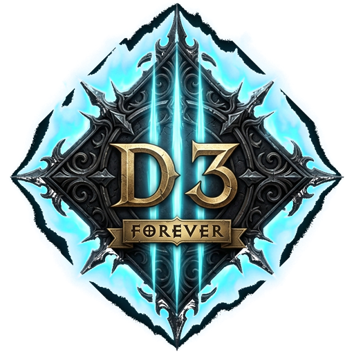
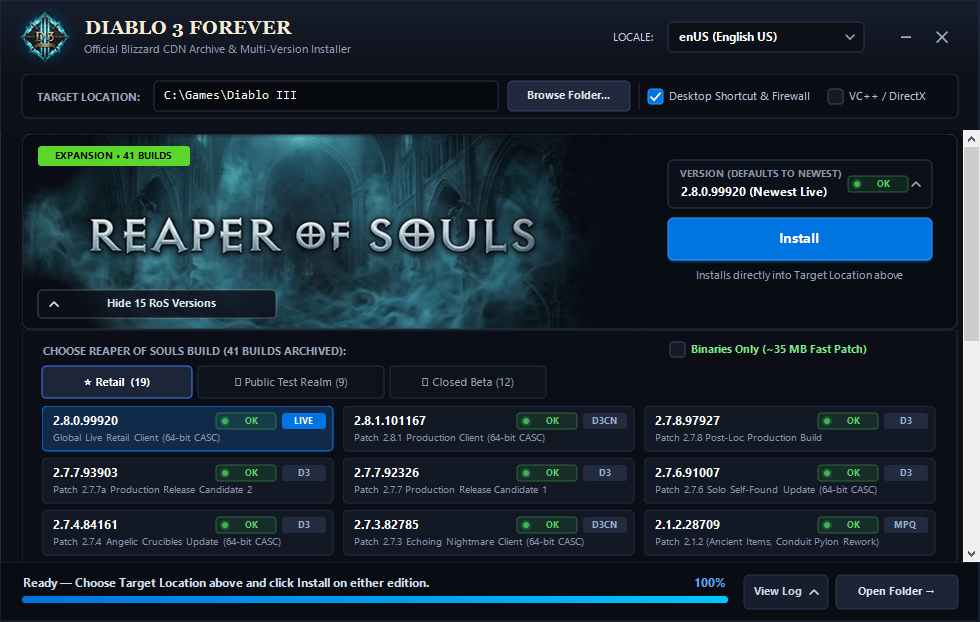

<div align="center">



# Diablo 3 Forever
### Historical Archive Downloader, Multi-Version Installer & Offline Game Builder
**by Elite Level Software**

[](https://github.com/EliteLevelSoftware/D3Forever/releases)
[](https://dotnet.microsoft.com/)
[](LICENSE)
[](https://github.com/EliteLevelSoftware/D3Forever/releases)
[](https://github.com/EliteLevelSoftware/D3Forever/releases)
[](https://github.com/EliteLevelSoftware/D3Forever/releases/latest)

**[⬇️ Download the latest version](https://github.com/EliteLevelSoftware/D3Forever/releases/latest)**

</div>

---

**Diablo 3 Forever** (v1.4.2) is a standalone, zero-dependency open-source archival downloader and multi-version installer that streams, reconstructs, and archives **93 official Diablo III builds** (spanning retail releases, Public Test Realm PTR iterations, and closed/open beta milestone clients from 2011 to 2025) **100% directly from Blizzard's official CDN servers**.

> ### **[Download `Diablo3Forever.exe` v1.4.2 (Standalone Windows x64 - Zero Dependencies)](https://github.com/EliteLevelSoftware/D3Forever/releases/download/v1.4.2/Diablo3Forever.exe)**
> - **Version:** `v1.4.2`
> - **SHA-256:** `5c62ef6fb8fb453906d86363c0d5247d6ba9056c86e58869479812089466afa2` ([`release/SHA256SUMS.txt`](release/SHA256SUMS.txt))
> - **Build Catalog & Provenance Tracker:** [`docs/Diablo3_Versions_Tracker_Enriched.xlsx`](docs/Diablo3_Versions_Tracker_Enriched.xlsx)
> - Or browse **[GitHub Releases](https://github.com/EliteLevelSoftware/D3Forever/releases)**



---

## Key Features

- **100% Direct from Official Blizzard CDNs:** Every byte of the 83 legacy MPQ builds and live CASC clients is fetched directly from Blizzard's official distribution servers (`us.patch.battle.net`, `us.cdn.blizzard.com`, and `dist.blizzard.com.edgesuite.net`). Zero third-party mirrors, re-uploads, or modified game binaries are used.

> [!NOTE]
> ### 🔍 Blizzard CDN Reality: Legacy MPQ vs. Live CASC vs. Historical CASC
> - **🟢 83 Legacy MPQ Builds (100% Live CDN Download):** Every single Vanilla milestone (Friends & Family Beta `7162` through Patch `1.0.8a`) and Reaper of Souls MPQ build (`2.0.0` through `2.1.2`) remains **100% intact and actively hosted** across Blizzard's Akamai/EdgeSuite CDN servers. Full clients and binaries download directly in seconds with zero external dependencies.
> - **🟢 Live Retail CASC (100% Live CDN Download):** Current retail builds (`2.8.0.99920` and China `2.8.1.101167`) are live and streamable directly from Blizzard's NGDP infrastructure.
> - **🟢 Patch 2.7.4.84161 (100% Live CDN Download - Server Standard):** All standalone executables (`Diablo III64.exe`, `Diablo III.exe`), DLLs, and 17.37 GB of shared CASC game assets stream directly from live Blizzard CDN edge nodes with bit-for-bit MD5 CKey cryptographic verification. No external files required.
> - **⚡ Historical CASC Builds (2.6.4 – 2.7.8 / Hybrid CASC Pipeline):** Manifest configurations (`BuildConfig`, `CDNConfig`, `install`, `encoding`) and all 17.37 GB of shared archive assets remain active on Blizzard's CDN. Diablo 3 Forever automatically federates shared CASC archives and uses the Option B Clean Binary Package system to recover patch binaries without fragile diffing.

- **Bulk Archival & Cold Storage Backup Engine:** Backup and preserve the entire 93-build catalog to an external hard drive, USB storage, or network share (NAS):
  - **Live Destination Inventory Tracker:** Automatically inspects the destination drive in real time, displaying present vs. needed builds and guaranteeing 100% incremental resume (already verified files are never re-downloaded).
  - **Dual-Mode Archival:** Download Fast Binaries AND the Raw Blizzard CDN Mirror at the same time via dual checkboxes.
  - **⚡ Fast Binaries Archive (~3.3 GB Total):** Reconstructs standalone ready-to-run executables (`Diablo III.exe`), DLLs, and multi-locale launch scripts for all 93 builds.
  - **📦 Raw Blizzard CDN Mirror:** Mirrors original unpatched Base MPQ archives, all 85 historical patch MPQs (`Updates/d3-0-*.MPQ`), and manifests for 100% offline cold storage.
  - **Universal Multi-Language Pack (+~400 MB):** Includes translated text for ALL 13 official languages (`enUS`, `deDE`, `frFR`, `esES`, `ruRU`, `koKR`, `zhTW`, etc.) allowing any build to be launched in any language worldwide while saving over 32 GB of duplicate audio!
  - **Offline Complete Game Assembler:** Assemble any historical build into a complete, 100% playable game client directly from your offline archive with ZERO internet connection required.
  - **Integrity & Metadata:** Automatically generates `SHA256SUMS.txt`, `VERSION_INFO.txt`, and interactive `Launch-Game.bat` scripts per build.
- **Segmented Drawer Tabs:** Both the **Reaper of Souls** and **Vanilla Classic** expansion drawers feature category tab selectors:
  - `⭐ Retail`: Official production retail patches and milestone base clients.
  - `🧪 Public Test Realm`: Historical PTR iterations, preview patches, and test candidates.
  - `🔒 Closed Beta`: Milestone Friends & Family, Closed Beta, and Open Beta builds (including Vanilla `7162`–`9359` and RoS `18962`–`21962`).
- **Real-Time Per-File CDN Availability Tracking:** Every single version chip displays an animated breathing status dot that probes Blizzard's CDN in real-time (`OK`, `CHECKING`, `OFFLINE`).
- **Fast "Binaries Only" Mode (~35 MB Fast Patch):** Need only the exact historical `Diablo III.exe` and DLLs for a specific patch without downloading 15 GB of assets? Both Reaper of Souls and Vanilla drawers feature a **Binaries Only (~35 MB Fast Patch)** checkbox to extract, patch, and verify clean binaries in seconds.
- **GUI + Headless CLI Support:** Run `Diablo3Forever.exe` with no arguments for the interactive GUI, or pass CLI flags for 100% silent, unattended deployment and batch backups.

---

## Headless CLI & Bulk Backup Usage

```powershell
# Interactive GUI
.\Diablo3Forever.exe

# List all 93 official Blizzard CDN builds with release dates and provenance
.\Diablo3Forever.exe --list-versions

# Install a specific historical build directly from Blizzard CDN
.\Diablo3Forever.exe --build 16603 "C:\Games\Diablo III 1.0.8a"
.\Diablo3Forever.exe --version "2.1.2" "C:\Games\Diablo III 2.1.2" --binaries-only
.\Diablo3Forever.exe --build 84161 "C:\Games\Diablo III 2.7.4" --binaries-only

# Bulk Backup all 93 builds to external storage or NAS (Fast Binaries Mode ~3.3 GB)
.\Diablo3Forever.exe --backup-all "E:\Diablo3_Historical_Archive" --backup-mode binaries --backup-scope all

# Complete Raw Blizzard CDN Offline Mirror (~48 GB)
.\Diablo3Forever.exe --backup-all "E:\Diablo3_Cold_Storage" --backup-mode raw --backup-scope all
```

---

## Supported Official CDN Builds (93 Versions)

### Reaper of Souls (43 Builds Across Retail, PTR & Beta)

#### Retail Releases (22 Builds)

| Version | Build | Architecture | Availability | Release Date | Summary / Highlights |
| :--- | :--- | :--- | :--- | :--- | :--- |
| **`2.8.0`** | `99920` | CASC 64-bit | 🟢 Live CDN | Live Retail | Global Live Retail Client (64-bit CASC) |
| **`2.8.1`** | `101167` | CASC 64-bit | 🟢 Live CDN | CN CDN | Patch 2.8.1 Production Client (64-bit CASC) |
| **`2.7.8`** | `97927` | CASC 64-bit | ⚡ Hybrid CASC | 2024-09-10 | Patch 2.7.8 Post-Loc Production Build (Option B Delta) |
| **`2.7.7`** | `93903` | CASC 64-bit | ⚡ Hybrid CASC | 2024-02-06 | Patch 2.7.7a Production Release Candidate 2 (Option B Delta) |
| **`2.7.7`** | `92326` | CASC 64-bit | ⚡ Hybrid CASC | 2024-01-09 | Patch 2.7.7 Production Release Candidate 1 (Option B Delta) |
| **`2.7.6`** | `91007` | CASC 64-bit | ⚡ Hybrid CASC | 2023-09-12 | Patch 2.7.6 Solo Self-Found Update (Option B Delta) |
| **`2.7.4`** | `84161` | CASC 64-bit | 🟢 Live CDN | 2022-08-23 | Patch 2.7.4 Angelic Crucibles (Live CDN + Server Standard) |
| **`2.7.3`** | `82785` | CASC 64-bit | ⚡ Hybrid CASC | 2022-04-12 | Patch 2.7.3 Echoing Nightmare Client (Option B Delta) |
| **`2.6.10`** | `71254` | CASC 64-bit | ⚡ Hybrid CASC | 2020-11-10 | Patch 2.6.10 Shadow Clones (Option B Delta) |
| **`2.6.9`** | `68722` | CASC 64-bit | ⚡ Hybrid CASC | 2020-06-23 | Patch 2.6.9 Trials of Tempests (Option B Delta) |
| **`2.6.4`** | `55430` | CASC 64-bit | ⚡ Hybrid CASC | 2019-01-15 | Patch 2.6.4 Season of Grandeur (Option B Delta) |
| **`2.1.2`** | `28709` | MPQ 32-bit | 🟢 Live CDN | 2015-01-13 | Patch 2.1.2 (Ancient Items, Conduit Pylon Rework) |
| **`2.1.1`** | `27255` | MPQ 32-bit | 🟢 Live CDN | 2014-09-23 | Patch 2.1.1 (Kadala Bloodshard Costs, Pet Toughness) |
| **`2.1.0`** | `26451` | MPQ 32-bit | 🟢 Live CDN | 2014-08-26 | Major Update (Greater Rifts, Legendary Gems, The Vault) |
| **`2.0.6`** | `24641` | MPQ 32-bit | 🟢 Live CDN | 2014-06-10 | Patch 2.0.6 (Crafting Material Removal, Class Balancing) |
| **`2.0.5a`** | `24017` | MPQ 32-bit | 🟢 Live CDN | 2014-05-15 | Patch 2.0.5a Stability & Bugfix Hotfix |
| **`2.0.5`** | `23920` | MPQ 32-bit | 🟢 Live CDN | 2014-05-13 | Patch 2.0.5 (Horadric Cache Torment Drop Rates, Gold Trade) |
| **`2.0.4`** | `23119` | MPQ 32-bit | 🟢 Live CDN | 2014-04-08 | Patch 2.0.4 (Crusader Wrath Fixes, Class Tweaks) |
| **`2.0.3`** | `22427` | MPQ 32-bit | 🟢 Live CDN | 2014-03-11 | Patch 2.0.3 Bugfix & Stability Update |
| **`2.0.2`** | `22274` | MPQ 32-bit | 🟢 Live CDN | 2014-03-04 | Patch 2.0.2 Pre-Expansion Optimization Patch |
| **`2.0.1`** | `22044` | MPQ 32-bit | 🟢 Live CDN | 2014-02-25 | Reaper of Souls Pre-Patch (Loot 2.0, Paragon 2.0) |
| **`2.0.0`** | `20813` | MPQ 32-bit | 🟢 Live CDN | 2014-01-20 | Reaper of Souls Unpatched Retail Base MPQ Build |

#### Public Test Realm (PTR) (9 Builds)

| Version | Build | Architecture | Availability | Release Date | Summary / Highlights |
| :--- | :--- | :--- | :--- | :--- | :--- |
| **`2.7.8`** | `96670` | CASC 64-bit | 🟡 Offline Archive | 2024-08-20 | Patch 2.7.8 Public Test Realm Client (64-bit CASC) |
| **`2.1.2`** | `28709` | MPQ 32-bit | 🟢 Live CDN | 2015-01-08 | Patch 2.1.2 PTR Release Candidate Build |
| **`2.1.2`** | `28341` | MPQ 32-bit | 🟢 Live CDN | 2014-11-20 | Patch 2.1.2 PTR Wave 1 (Ancient Items Debut) |
| **`2.1.0`** | `26370` | MPQ 32-bit | 🟢 Live CDN | 2014-08-06 | Patch 2.1.0 PTR Release Candidate Build |
| **`2.1.0`** | `26281` | MPQ 32-bit | 🟢 Live CDN | 2014-07-30 | Patch 2.1.0 PTR Iteration 4 (Greater Rift Pacing) |
| **`2.1.0`** | `26067` | MPQ 32-bit | 🟢 Live CDN | 2014-07-23 | Patch 2.1.0 PTR Iteration 3 (Seasons Testing) |
| **`2.1.0`** | `25658` | MPQ 32-bit | 🟢 Live CDN | 2014-07-16 | Patch 2.1.0 PTR Iteration 2 (Legendary Gems Balance) |
| **`2.1.0`** | `25390` | MPQ 32-bit | 🟢 Live CDN | 2014-07-09 | Patch 2.1.0 PTR Iteration 1 (Cesspools & Greater Rifts) |
| **`2.1.0`** | `25014` | MPQ 32-bit | 🟢 Live CDN | 2014-06-25 | Patch 2.1.0 Initial PTR Launch Build |

#### Closed Beta (12 Builds)

| Version | Build | Architecture | Release Date | Summary / Highlights |
| :--- | :--- | :--- | :--- | :--- |
| **`Beta`** | `21962` | MPQ 32-bit | 2014-02-20 | RoS Closed Beta Final Patch Before 2.0 Pre-Patch |
| **`Beta`** | `21806` | MPQ 32-bit | 2014-02-13 | RoS Closed Beta Iteration 9 (Crusader Final Polish) |
| **`Beta`** | `21390` | MPQ 32-bit | 2014-02-06 | RoS Closed Beta Iteration 8 (Torment Scaling) |
| **`Beta`** | `20874` | MPQ 32-bit | 2013-12-13 | RoS Closed Beta Patch 2.0.1 In-Game Notes Update |
| **`Beta`** | `20493` | MPQ 32-bit | 2014-01-22 | RoS Closed Beta Iteration 6 (Nephalem Rifts) |
| **`Beta`** | `20134` | MPQ 32-bit | 2014-01-15 | RoS Closed Beta Iteration 5 (Blood Shards) |
| **`Beta`** | `19992` | MPQ 32-bit | 2014-01-08 | RoS Closed Beta Iteration 4 (Adventure Mode) |
| **`Beta`** | `19862` | MPQ 32-bit | 2013-12-23 | RoS Closed Beta Iteration 3 (Kadala Gambling) |
| **`Beta`** | `19796` | MPQ 32-bit | 2013-12-19 | RoS Closed Beta Iteration 2 (Bounties System) |
| **`Beta`** | `19561` | MPQ 32-bit | 2013-12-12 | RoS Closed Beta Iteration 1 (Act V Westmarch) |
| **`Beta`** | `19177` | MPQ 32-bit | 2013-12-03 | RoS Closed Beta F&F First Update Patch |
| **`Beta`** | `18962` | MPQ 32-bit | 2013-08-30 | Original RoS Friends & Family Closed Beta Base Client |


### Vanilla Classic (50 Builds Across Retail, PTR & Beta)

#### Retail Releases (18 Builds)

| Version | Build | Architecture | Release Date | Summary / Highlights |
| :--- | :--- | :--- | :--- | :--- |
| **`1.0.8a`** | `16603` | MPQ 32-bit | 2013-05-10 | Final Vanilla 1.0.8 Hotfix Build |
| **`1.0.8`** | `16416` | MPQ 32-bit | 2013-05-07 | Monster Density & Co-op XP Bonus Patch |
| **`1.0.7a`** | `15295` | MPQ 32-bit | 2013-02-15 | Duelling & Demon Hunter Hotfix |
| **`1.0.7`** | `14633` | MPQ 32-bit | 2013-02-12 | Brawling, Marquise Gems & BoA Crafting |
| **`1.0.6a`** | `13644` | MPQ 32-bit | 2012-12-06 | Quest & Stability Patch |
| **`1.0.6`** | `13300` | MPQ 32-bit | 2012-11-27 | Network & Bugfix Patch |
| **`1.0.5a`** | `12811` | MPQ 32-bit | 2012-10-25 | Crash & Achievement Fix Patch |
| **`1.0.5`** | `12480` | MPQ 32-bit | 2012-10-16 | Monster Power (MP1-10) & Infernal Machine |
| **`1.0.4`** | `11327` | MPQ 32-bit | 2012-08-21 | Paragon 1.0 (Levels 1-100) & Legendary Overhaul |
| **`1.0.3b`** | `10485` | MPQ 32-bit | 2012-07-10 | Auction House & Stability Patch |
| **`1.0.3a`** | `10235` | MPQ 32-bit | 2012-06-26 | Zombie Bears & General Bugfix Patch |
| **`1.0.3`** | `10057` | MPQ 32-bit | 2012-06-19 | Inferno Tuning, IAS Nerf & Repair Cost Patch |
| **`1.0.2c`** | `9991` | MPQ 32-bit | 2012-06-12 | Mac/PC Client Stability Patch |
| **`1.0.2b`** | `9950` | MPQ 32-bit | 2012-06-07 | Login & Auction House Responsiveness Patch |
| **`1.0.2a`** | `9858` | MPQ 32-bit | 2012-06-01 | Item & Skill Tooltip Fix Patch |
| **`1.0.2`** | `9749` | MPQ 32-bit | 2012-05-29 | First Post-Launch Client Patch |
| **`1.0.1`** | `9558` | MPQ 32-bit | 2012-05-15 | Original May 15, 2012 Launch Day Patch |
| **`1.0.0`** | `8370` | MPQ 32-bit | 2012-05-14 | Original Unpatched Retail DVD Base MPQ Build |

#### Public Test Realm (PTR) (13 Builds)

| Version | Build | Architecture | Release Date | Summary / Highlights |
| :--- | :--- | :--- | :--- | :--- |
| **`1.0.8`** | `16256` | MPQ 32-bit | 2013-04-30 | Patch 1.0.8 PTR Release Candidate 4 |
| **`1.0.8`** | `16107` | MPQ 32-bit | 2013-04-23 | Patch 1.0.8 PTR Iteration 3 (Matchmaking Tags) |
| **`1.0.8`** | `16033` | MPQ 32-bit | 2013-04-16 | Patch 1.0.8 PTR Iteration 2 (Identify All & Density) |
| **`1.0.8`** | `15926` | MPQ 32-bit | 2013-04-09 | Patch 1.0.8 Initial PTR Launch Build |
| **`1.0.7`** | `14528` | MPQ 32-bit | 2013-02-05 | Patch 1.0.7 PTR Release Candidate 4 |
| **`1.0.7`** | `14456` | MPQ 32-bit | 2013-01-29 | Patch 1.0.7 PTR Iteration 3 (Marquise Gems Balance) |
| **`1.0.7`** | `14295` | MPQ 32-bit | 2013-01-22 | Patch 1.0.7 PTR Iteration 2 (Archon & Tempest Rush) |
| **`1.0.7`** | `14161` | MPQ 32-bit | 2013-01-15 | Patch 1.0.7 Initial PTR Launch Build (Brawling) |
| **`1.0.5`** | `12389` | MPQ 32-bit | 2012-10-08 | Patch 1.0.5 PTR Release Candidate 4 |
| **`1.0.5`** | `12289` | MPQ 32-bit | 2012-10-02 | Patch 1.0.5 PTR Iteration 3 (Infernal Machine) |
| **`1.0.5`** | `12166` | MPQ 32-bit | 2012-09-24 | Patch 1.0.5 PTR Iteration 2 (Monster Power) |
| **`1.0.5`** | `12150` | MPQ 32-bit | 2012-09-21 | Patch 1.0.5 Initial PTR Launch Build |
| **`1.0.3`** | `10485` | MPQ 32-bit | 2012-07-10 | Vanilla PTR Base Client Archive |

#### Closed & Open Beta (19 Builds)

| Version | Build | Architecture | Release Date | Summary / Highlights |
| :--- | :--- | :--- | :--- | :--- |
| **`Beta`** | `9359` | MPQ 32-bit | 2012-04-19 | Vanilla Open Beta Weekend Client (April 20-23, 2012) |
| **`Beta`** | `9327` | MPQ 32-bit | 2012-04-17 | Vanilla Beta Patch 17 |
| **`Beta`** | `9183` | MPQ 32-bit | 2012-04-09 | Vanilla Beta Patch 16 |
| **`Beta`** | `8896` | MPQ 32-bit | 2012-03-16 | Vanilla Beta Patch 15 |
| **`Beta`** | `8815` | MPQ 32-bit | 2012-03-08 | Vanilla Beta Patch 14 (Hardcore Mode Added) |
| **`Beta`** | `8610` | MPQ 32-bit | 2012-02-18 | Vanilla Beta Patch 13 (Skill Rune System Overhaul) |
| **`Beta`** | `8392` | MPQ 32-bit | 2012-02-03 | Vanilla Beta Patch 12 |
| **`Beta`** | `8350` | MPQ 32-bit | 2012-01-30 | Vanilla Beta Patch 11 |
| **`Beta`** | `8296` | MPQ 32-bit | 2012-01-23 | Vanilla Beta Patch 10 |
| **`Beta`** | `8101` | MPQ 32-bit | 2011-12-20 | Vanilla Beta Patch 9 (Attribute & Skill Overhaul) |
| **`Beta`** | `8059` | MPQ 32-bit | 2011-12-15 | Vanilla Beta Patch 8 (BattleTags Introduced) |
| **`Beta`** | `7931` | MPQ 32-bit | 2011-12-01 | Vanilla Beta Patch 7 (Real-Money Auction House) |
| **`Beta`** | `7841` | MPQ 32-bit | 2011-11-17 | Vanilla Beta Patch 6 (Profiles & Achievements) |
| **`Beta`** | `7728` | MPQ 32-bit | 2011-11-03 | Vanilla Beta Patch 5 (Demon Hunter Rework) |
| **`Beta`** | `7447` | MPQ 32-bit | 2011-09-26 | Vanilla Beta Patch 4 (Server Data Removed) |
| **`Beta`** | `7338` | MPQ 32-bit | 2011-09-14 | Vanilla Beta Patch 3 (Auction House Added) |
| **`Beta`** | `7318` | MPQ 32-bit | 2011-09-07 | Vanilla Beta Patch 2 |
| **`Beta`** | `7200` | MPQ 32-bit | 2011-09-02 | Vanilla Beta Patch 1 (Friends & Family Launch) |
| **`Beta`** | `7162` | MPQ 32-bit | 2011-08-18 | Original Vanilla Friends & Family Beta Base Client |

---

## Command-Line (Headless) Usage

```powershell
# Launch the interactive GUI (default when no flags are passed)
Diablo3Forever.exe

# List all 93 official CDN builds and exit
Diablo3Forever.exe --list-versions

# Install the newest Live Reaper of Souls (2.8.0.99920) silently
Diablo3Forever.exe "C:\Games\Diablo III" --build 2.8.0 --locale enUS

# Install full playable Vanilla 1.0.8a (Build 16603)
Diablo3Forever.exe "C:\Games\Diablo III Vanilla" --build 16603 --locale enUS

# Fast-build ONLY the patched Vanilla binaries (~35 MB download) for 1.0.3 (Build 10057)
Diablo3Forever.exe "C:\Games\D3-1.0.3-Binaries" --build 10057 --binaries-only

# Fast-build ONLY the 2014 Reaper of Souls 2.0.1 binaries (~35 MB download)
Diablo3Forever.exe "C:\Games\D3-2.0.1-Binaries" --build 22044 --binaries-only
```

---

## Building from Source

Requires the [.NET 8.0+ / 10.0 SDK](https://dotnet.microsoft.com/download) on Windows:

```powershell
dotnet publish src/Diablo3Forever.csproj -c Release -r win-x64 --self-contained true -p:PublishSingleFile=true -p:IncludeNativeLibrariesForSelfExtract=true -p:EnableCompressionInSingleFile=true -o release
```

---

## Legal & Non-Affiliation Disclaimer

- **Not Affiliated with Blizzard Entertainment:** This project is an independent, open-source community archival and deployment tool and is **not** affiliated with, endorsed by, or sponsored by Blizzard Entertainment, Inc. or Microsoft Corporation.
- **Trademarks:** *Diablo*, *Diablo III*, *Reaper of Souls*, and *Battle.net* are trademarks or registered trademarks of Blizzard Entertainment, Inc. in the U.S. and/or other countries.
- **Original Custom Artwork:** All UI banners, icons, and emblems bundled in [`src/Assets/`](src/Assets) (`ros_banner.jpg`, `vanilla_banner.jpg`, `d3forever_logo.png`, `app_icon.ico`) are **100% original, custom-generated dark-fantasy artwork** created specifically for this project and contain no copyrighted Blizzard promotional key art or official game logos.
- **No Copyrighted Game Code Redistributed & No DRM Bypass:** This repository contains **zero** Blizzard game binaries, MPQ archives, or proprietary code. All game files are downloaded directly by the end user from Blizzard's official public CDN servers. This tool does **not** bypass Battle.net authentication, modify game logic, or circumvent license checks - a valid Battle.net account and Diablo III license are required to play on official servers.
