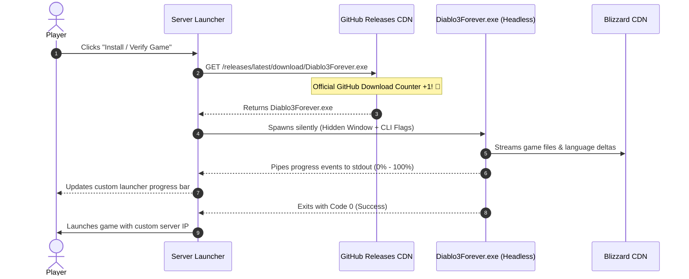

# Diablo 3 Forever — Server Launcher Integration Guide & Dev Kit

Welcome to the **Diablo 3 Forever Launcher Integration Guide**! 

If you operate a Diablo III private server (such as a [DiIiS](https://github.com/DiIiS-project) community server) or maintain a custom client launcher, you do **not** need to ask your players to download third-party installers or search the internet for gigabytes of game archives. 

Instead, you can embed **Diablo 3 Forever** directly into your launcher to silently download, assemble, and verify the exact required game client and language packs **100% directly from official Blizzard CDN edge nodes**.

---

## 🚀 Quick Start: Interactive Code Generator ("Launcher Dev Kit")

Diablo 3 Forever includes a built-in **Launcher Integration Studio** that asks you a few simple questions and automatically generates ready-to-paste source code for your launcher.

### How to Open the Studio:
1. **From the GUI:** Click the **🚀 LAUNCHER DEV KIT** button on the top toolbar of `Diablo3Forever.exe`.
2. **From the Command Line:** Run:
   ```cmd
   Diablo3Forever.exe --launcher-wizard
   ```
3. Select your programming language (C#, Electron, Python, PowerShell, Batch, or C++), pick your target build (e.g. `2.7.4.84161`), and click **📋 COPY CODE** or **💾 EXPORT FILE**.

---

## 📈 How GitHub Download Attribution Works

When your launcher downloads the `Diablo3Forever.exe` binary, make sure it points to our official GitHub Release URL:

```
https://github.com/EliteLevelSoftware/D3Forever/releases/latest/download/Diablo3Forever.exe
```

* **Official Metric Tracking:** Whenever any client or launcher requests this redirect URL, **GitHub increments our repository's official release download counter by 1**.
* If your private server has 5,000 active players, every automated setup triggers a verified download on GitHub, directly supporting and increasing the visibility of the Diablo 3 Forever open-source project.

---

## 🛠️ Complete Integration Architecture



---

## 💻 Production Code Snippets

### 1. C# / .NET (WPF / WinForms / Console)
*Most common for Diablo III private server launchers (e.g., DiIiS).*

```csharp
using System;
using System.Diagnostics;
using System.IO;
using System.Net.Http;
using System.Security.Cryptography;
using System.Threading.Tasks;

public static class D3GameInstaller
{
    private const string GitHubReleaseUrl = "https://github.com/EliteLevelSoftware/D3Forever/releases/latest/download/Diablo3Forever.exe";
    private const string GitHubSha256Url = "https://github.com/EliteLevelSoftware/D3Forever/releases/latest/download/SHA256SUMS.txt";

    public static async Task InstallOrUpdateAsync(
        string targetDir = @"C:\Games\Diablo III", 
        string build = "84161", 
        string locale = "enUS", 
        Action<string> onStatus = null)
    {
        string toolsDir = Path.Combine(AppDomain.CurrentDomain.BaseDirectory, "tools");
        Directory.CreateDirectory(toolsDir);
        string exePath = Path.Combine(toolsDir, "Diablo3Forever.exe");

        // Step 1: Ensure engine is downloaded and verify official SHA-256 fingerprint
        if (!File.Exists(exePath))
        {
            onStatus?.Invoke("Downloading installer engine from GitHub Releases...");
            using var http = new HttpClient();
            byte[] binaryBytes = await http.GetByteArrayAsync(GitHubReleaseUrl);
            await File.WriteAllBytesAsync(exePath, binaryBytes);

            try
            {
                string sums = await http.GetStringAsync(GitHubSha256Url);
                string expectedHash = null;
                foreach (var line in sums.Split('\n'))
                {
                    if (line.Contains("Diablo3Forever.exe", StringComparison.OrdinalIgnoreCase))
                    {
                        expectedHash = line.Split(new[] { ' ', '\t' }, StringSplitOptions.RemoveEmptyEntries)[0].Trim();
                        break;
                    }
                }
                if (!string.IsNullOrEmpty(expectedHash))
                {
                    using var sha = SHA256.Create();
                    string actualHash = Convert.ToHexString(sha.ComputeHash(binaryBytes));
                    if (!string.Equals(expectedHash, actualHash, StringComparison.OrdinalIgnoreCase))
                    {
                        File.Delete(exePath);
                        throw new InvalidOperationException($"Security alert: Fingerprint mismatch! Expected {expectedHash}, got {actualHash}");
                    }
                }
            }
            catch (Exception ex) when (ex is not InvalidOperationException)
            {
                onStatus?.Invoke($"[Note] Fingerprint check skipped: {ex.Message}");
            }
        }

        // Step 2: Run headless installation directly from official Blizzard CDN
        onStatus?.Invoke($"Streaming Diablo III Build {build} ({locale}) from Blizzard CDN...");
        var psi = new ProcessStartInfo
        {
            FileName = exePath,
            Arguments = $"\"{targetDir}\" --build {build} --locale {locale}",
            UseShellExecute = false,
            CreateNoWindow = true,
            RedirectStandardOutput = true
        };

        using var proc = Process.Start(psi);
        while (!proc.StandardOutput.EndOfStream)
        {
            string line = await proc.StandardOutput.ReadLineAsync();
            if (!string.IsNullOrWhiteSpace(line)) onStatus?.Invoke(line);
        }
        await proc.WaitForExitAsync();

        if (proc.ExitCode == 0)
        {
            onStatus?.Invoke("Installation completed successfully with 0 errors!");
        }
        else if (proc.ExitCode == 2)
        {
            onStatus?.Invoke("[Warning] Installation completed with missing legacy CDN chunks. Binaries are intact.");
        }
        else if (proc.ExitCode == 130)
        {
            onStatus?.Invoke("Installation was canceled.");
            return;
        }
        else
        {
            throw new InvalidOperationException($"Installation failed with exit code {proc.ExitCode}");
        }
    }

    public static void LaunchGame(string targetDir, string serverHost = "logon.myserver.com", int serverPort = 1119)
    {
        string exe64 = Path.Combine(targetDir, "x64", "Diablo III64.exe");
        string exe32 = Path.Combine(targetDir, "Diablo III.exe");
        string exe = File.Exists(exe64) ? exe64 : exe32;

        Process.Start(new ProcessStartInfo
        {
            FileName = exe,
            Arguments = $"-launch -authserver {serverHost} -authport {serverPort}",
            WorkingDirectory = targetDir
        });
    }
}
```

---

### 2. Electron / Node.js / TypeScript
*Standard for modern HTML5/JS desktop launchers.*

```javascript
const fs = require('fs');
const path = require('path');
const https = require('https');
const crypto = require('crypto');
const { spawn } = require('child_process');

const GITHUB_RELEASE_URL = 'https://github.com/EliteLevelSoftware/D3Forever/releases/latest/download/Diablo3Forever.exe';
const GITHUB_SHA256_URL = 'https://github.com/EliteLevelSoftware/D3Forever/releases/latest/download/SHA256SUMS.txt';

async function installGame(targetDir = 'C:\\Games\\Diablo III', build = '84161', locale = 'enUS', onProgress = console.log) {
  const toolsDir = path.join(__dirname, 'tools');
  if (!fs.existsSync(toolsDir)) fs.mkdirSync(toolsDir, { recursive: true });
  const exePath = path.join(toolsDir, 'Diablo3Forever.exe');

  // Step 1: Download from GitHub and verify SHA-256 fingerprint
  if (!fs.existsSync(exePath)) {
    onProgress('Downloading installer engine from GitHub...');
    await downloadFromGitHub(GITHUB_RELEASE_URL, exePath);

    try {
      const sumsText = await fetchText(GITHUB_SHA256_URL);
      const match = sumsText.split('\n').find(l => l.includes('Diablo3Forever.exe'));
      if (match) {
        const expectedHash = match.trim().split(/\s+/)[0].toLowerCase();
        const fileBuffer = fs.readFileSync(exePath);
        const actualHash = crypto.createHash('sha256').update(fileBuffer).digest('hex').toLowerCase();
        if (expectedHash !== actualHash) {
          fs.unlinkSync(exePath);
          throw new Error(`Fingerprint mismatch! Expected ${expectedHash}, got ${actualHash}`);
        }
      }
    } catch (err) {
      if (err.message.includes('Fingerprint mismatch')) throw err;
      onProgress(`[Note] Fingerprint check skipped: ${err.message}`);
    }
  }

  // Step 2: Spawn headless process
  onProgress('Streaming game data from Blizzard CDN...');
  return new Promise((resolve, reject) => {
    const proc = spawn(exePath, [targetDir, '--build', build, '--locale', locale], { windowsHide: true });

    proc.stdout.on('data', (data) => {
      const msg = data.toString().trim();
      if (msg) onProgress(msg);
    });

    proc.on('close', (code) => {
      if (code === 0) {
        onProgress('Installation completed successfully!');
        resolve();
      } else if (code === 2) {
        onProgress('[Warning] Installed with missing legacy chunks from CDN. Binaries intact.');
        resolve();
      } else if (code === 130) {
        onProgress('Installation canceled.');
        resolve();
      } else {
        reject(new Error(`Installer exited with code ${code}`));
      }
    });
  });
}

function launchGame(targetDir, serverHost = 'logon.myserver.com', serverPort = 1119) {
  const exe64 = path.join(targetDir, 'x64', 'Diablo III64.exe');
  const exe = fs.existsSync(exe64) ? exe64 : path.join(targetDir, 'Diablo III.exe');

  spawn(exe, ['-launch', '-authserver', serverHost, '-authport', String(serverPort)], {
    cwd: targetDir,
    detached: true,
    stdio: 'ignore'
  }).unref();
}

function downloadFromGitHub(url, dest) {
  return new Promise((resolve, reject) => {
    const file = fs.createWriteStream(dest);
    https.get(url, (res) => {
      if (res.statusCode === 302 || res.statusCode === 301) {
        https.get(res.headers.location, (redRes) => {
          redRes.pipe(file);
          file.on('finish', () => file.close(resolve));
        }).on('error', reject);
      } else {
        res.pipe(file);
        file.on('finish', () => file.close(resolve));
      }
    }).on('error', reject);
  });
}

function fetchText(url) {
  return new Promise((resolve, reject) => {
    https.get(url, (res) => {
      if (res.statusCode === 302 || res.statusCode === 301) {
        fetchText(res.headers.location).then(resolve).catch(reject);
      } else {
        let data = '';
        res.on('data', chunk => data += chunk);
        res.on('end', () => resolve(data));
      }
    }).on('error', reject);
  });
}

module.exports = { installGame, launchGame };
```

---

### 3. Python 3 (Zero External Dependencies)

```python
import os
import sys
import hashlib
import subprocess
import urllib.request

GITHUB_URL = "https://github.com/EliteLevelSoftware/D3Forever/releases/latest/download/Diablo3Forever.exe"
SHA256_URL = "https://github.com/EliteLevelSoftware/D3Forever/releases/latest/download/SHA256SUMS.txt"

def install_game(target_dir=r"C:\Games\Diablo III", build="84161", locale="enUS", on_progress=print):
    tools_dir = os.path.join(os.path.dirname(__file__), "tools")
    os.makedirs(tools_dir, exist_ok=True)
    exe_path = os.path.join(tools_dir, "Diablo3Forever.exe")

    # Step 1: Download from GitHub and verify SHA-256 fingerprint
    if not os.path.exists(exe_path):
        on_progress("Downloading installer engine from GitHub Releases...")
        urllib.request.urlretrieve(GITHUB_URL, exe_path)

        try:
            with urllib.request.urlopen(SHA256_URL) as resp:
                sums = resp.read().decode('utf-8', errors='ignore')
            expected_hash = None
            for line in sums.splitlines():
                if "Diablo3Forever.exe" in line:
                    expected_hash = line.split()[0].lower()
                    break
            if expected_hash:
                with open(exe_path, "rb") as f:
                    actual_hash = hashlib.sha256(f.read()).hexdigest().lower()
                if actual_hash != expected_hash:
                    os.remove(exe_path)
                    raise RuntimeError(f"Fingerprint mismatch! Expected {expected_hash}, got {actual_hash}")
        except Exception as e:
            if "Fingerprint mismatch" in str(e): raise
            on_progress(f"[Note] Fingerprint check skipped: {e}")

    # Step 2: Run headless installer
    on_progress(f"Streaming Diablo III Build {build} from Blizzard CDN...")
    cmd = [exe_path, target_dir, "--build", str(build), "--locale", locale]
    
    si = subprocess.STARTUPINFO()
    si.dwFlags |= subprocess.STARTF_USESHOWWINDOW
    
    proc = subprocess.Popen(cmd, stdout=subprocess.PIPE, stderr=subprocess.STDOUT, text=True, startupinfo=si)
    for line in proc.stdout:
        clean = line.strip()
        if clean: on_progress(clean)
    proc.wait()
    
    if proc.returncode == 0:
        on_progress("Installation completed successfully!")
    elif proc.returncode == 2:
        on_progress("[Warning] Installed with missing legacy CDN chunks. Binaries intact.")
    elif proc.returncode == 130:
        on_progress("Installation canceled.")
        return
    else:
        raise RuntimeError(f"Installation failed with return code {proc.returncode}")

def launch_game(target_dir=r"C:\Games\Diablo III", server_host="logon.myserver.com", server_port=1119):
    exe64 = os.path.join(target_dir, "x64", "Diablo III64.exe")
    exe = exe64 if os.path.exists(exe64) else os.path.join(target_dir, "Diablo III.exe")
    subprocess.Popen([exe, "-launch", "-authserver", server_host, "-authport", str(server_port)], cwd=target_dir)
```

---

### 4. PowerShell Script (Single-File Launcher Setup)

```powershell
$TargetDir  = "C:\Games\Diablo III"
$ServerHost = "logon.myserver.com"
$ServerPort = 1119
$ToolExe    = "$env:TEMP\Diablo3Forever.exe"
$GitHubUrl  = "https://github.com/EliteLevelSoftware/D3Forever/releases/latest/download/Diablo3Forever.exe"
$Sha256Url  = "https://github.com/EliteLevelSoftware/D3Forever/releases/latest/download/SHA256SUMS.txt"

# 1. Download installer from GitHub and verify SHA-256 fingerprint
if (-not (Test-Path $ToolExe)) {
    Write-Host "Downloading Diablo3Forever from GitHub..." -ForegroundColor Cyan
    Invoke-WebRequest -Uri $GitHubUrl -OutFile $ToolExe

    try {
        $sums = (Invoke-RestMethod -Uri $Sha256Url) -split "`n"
        $match = $sums | Where-Object { $_ -like "*Diablo3Forever.exe*" } | Select-Object -First 1
        if ($match) {
            $expected = ($match -split '\s+')[0].Trim().ToLower()
            $actual = (Get-FileHash -Path $ToolExe -Algorithm SHA256).Hash.ToLower()
            if ($expected -ne $actual) {
                Remove-Item $ToolExe -Force
                throw "Fingerprint mismatch! Expected $expected, got $actual"
            }
        }
    } catch {
        if ($_.Exception.Message -like "*Fingerprint mismatch*") { throw }
        Write-Warning "Fingerprint check skipped: $($_.Exception.Message)"
    }
}

# 2. Run headless install directly from Blizzard CDN
Write-Host "Installing Diablo III 2.7.4 (Build 84161)..." -ForegroundColor Green
$proc = Start-Process -FilePath $ToolExe -ArgumentList "`"$TargetDir`" --build 84161 --locale enUS" -Wait -PassThru -NoNewWindow
if ($proc.ExitCode -eq 0) {
    Write-Host "Installation completed successfully!" -ForegroundColor Green
} elseif ($proc.ExitCode -eq 2) {
    Write-Warning "Installation completed with missing legacy CDN chunks. Binaries intact."
} elseif ($proc.ExitCode -eq 130) {
    Write-Host "Installation was canceled." -ForegroundColor Yellow
    exit 130
} else {
    Write-Error "Installation failed with exit code $($proc.ExitCode)"
    exit $proc.ExitCode
}

# 3. Launch game connected to server
$Exe = if (Test-Path "$TargetDir\x64\Diablo III64.exe") { "$TargetDir\x64\Diablo III64.exe" } else { "$TargetDir\Diablo III.exe" }
Start-Process -FilePath $Exe -ArgumentList "-launch -authserver $ServerHost -authport $ServerPort" -WorkingDirectory $TargetDir
```

---

## 🚦 Exit Codes & Status Handling

When integrating `Diablo3Forever.exe` into automated pipelines or background launcher workers, inspect the process exit code:

| Exit Code | Status | Meaning | Recommended Launcher Action |
| :---: | :--- | :--- | :--- |
| **`0`** | **Success** | Deployment finished with 0 errors. All binaries and CASC chunks verified. | Enable the Play / Launch button. |
| **`2`** | **Incomplete / Warning** | Binaries and accessible assets are intact, but one or more CASC data chunks are no longer hosted by Blizzard on CDN for this historical build. | Warn user or advise assembling from offline archive via GUI. |
| **`130`** | **Canceled** | The installation was cleanly interrupted and halted upon request. Partial downloads are safely indexed and resumable. | Update UI to "Installation Canceled" and let the user restart when ready. |
| **`1`** | **Fatal Error** | Network failure, permission error, disk full, or invalid command-line flags. | Display the error log to the player. |

---

## 🛑 Clean Graceful Cancellation

Launchers can cancel an active installation cleanly without force-killing `Diablo3Forever.exe` (which ensures open archives are flushed and indices remain intact for resuming):

1. **Sentinel File (Recommended for GUI Launchers):**  
   Create an empty file named `.cancel` or `.d3forever-cancel` inside the target installation folder:
   ```csharp
   File.WriteAllText(Path.Combine(targetDir, ".cancel"), "");
   ```
   Diablo 3 Forever monitors for this file every 500ms, immediately terminates workers, writes flushed indices, and exits cleanly with code `130`.

2. **Standard Input (Pipe Closure or Command):**  
   If your launcher redirects standard input (`RedirectStandardInput = true`), close the stream or write `"cancel\n"`:
   ```csharp
   proc.StandardInput.WriteLine("cancel");
   // or: proc.StandardInput.Close();
   ```

3. **Standard Console Interrupt:**  
   Sending `Ctrl+C` / `SIGINT` to the process triggers the registered shutdown handler.

---

## 🔄 Automatic Resuming of Interrupted Downloads

Diablo 3 Forever features an intelligent chunk-level CASC resume engine:
- If a download is paused, canceled, or network connectivity drops, **running the command again does not restart the 16 GB download**.
- The engine scans existing `data.NNN` storage containers, indexes all present chunk hashes, and resumes downloading only the remaining missing chunks directly to the active container.

---

## 🌐 On-Demand Language Pack Delivery (v1.4.5+)

If a player changes their desired audio or text language inside your launcher settings, your launcher can fetch the exact language delta without redownloading the entire game:

```powershell
Diablo3Forever.exe --build 84161 --language-packs "C:\Games\Diablo III\Packs" --languages ptBR,deDE
```

---

## 📋 Headless Command-Line Reference

| Command Flag | Description | Example |
| :--- | :--- | :--- |
| `"<path>"` | Target directory where the game will be installed. | `"C:\Games\Diablo III"` |
| `--build <id>` | Build number or version to install. | `--build 84161` or `--version 2.7.4` |
| `--locale <code>` | Primary locale for text and audio (`enUS`, `deDE`, `frFR`, `esES`, `ptBR`, `ruRU`, `koKR`, `zhTW`). | `--locale enUS` |
| `--binaries-only` | Installs only the executables and DLLs (~35 MB) without the 17 GB CASC asset archives. | `--binaries-only` |
| `--language-packs <dir>` | Exports language pack deltas without touching game files. | `--language-packs "D:\Packs"` |
| `--languages <list>` | Comma-separated list of languages or `all`. | `--languages ptBR,deDE` |
| `--fix-ngdp <path>` | Repairs and re-keys local NGDP `.build.info` and catalog files. | `--fix-ngdp "C:\Games\Diablo III"` |
| `--rebuild-casc <path>` | Rebuilds `.idx` indices from local `data.NNN` archives. | `--rebuild-casc "C:\Games\Diablo III"` |
| `--launcher-wizard` | Launches the interactive code generator GUI. | `--launcher-wizard` |
