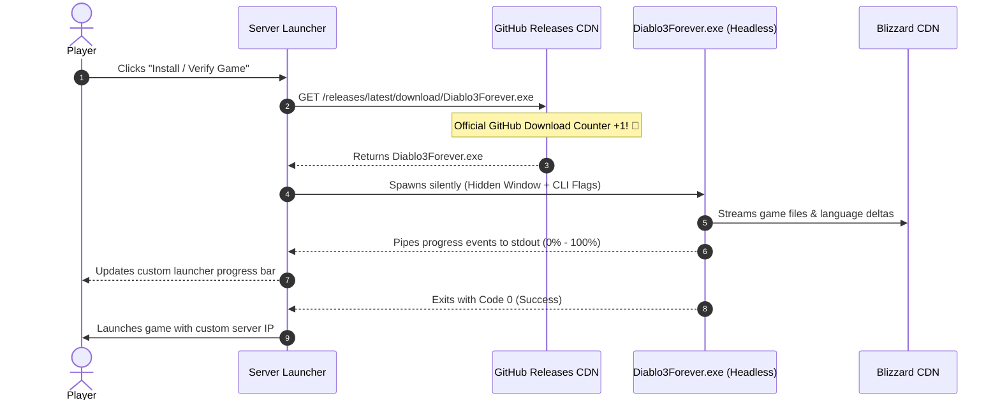

# Diablo 3 Forever — Server Launcher Integration Guide & Dev Kit

Welcome to the **Diablo 3 Forever Launcher Integration Guide**! 

If you operate a Diablo III private server (such as a [DiIiS](https://github.com/DiIiS-project) community server) or maintain a custom client launcher, you do **not** need to ask your players to download third-party installers or search the internet for gigabytes of game archives. 

Instead, you can embed **Diablo 3 Forever** directly into your launcher to silently download, assemble, and verify the exact required game client and language packs **100% directly from official Blizzard CDN edge nodes**.

---

## 🚀 Quick Start: Interactive Code Generator ("Launcher Dev Kit")

Diablo 3 Forever includes a built-in **Launcher Integration Studio** that asks you a few simple questions and automatically generates ready-to-paste source code for your launcher.

### How to Open the Studio:
1. **From the GUI:** Click the **🚀 LAUNCHER DEV KIT** button on the top toolbar of `Diablo3Forever.exe`.
2. **From the Command Line:** Run:
   ```cmd
   Diablo3Forever.exe --launcher-wizard
   ```
3. Select your programming language (C#, Electron, Python, PowerShell, Batch, or C++), pick your target build (e.g. `2.7.4.84161`), and click **📋 COPY CODE** or **💾 EXPORT FILE**.

---

## 📈 How GitHub Download Attribution Works

When your launcher downloads the `Diablo3Forever.exe` binary, make sure it points to our official GitHub Release URL:

```
https://github.com/EliteLevelSoftware/D3Forever/releases/latest/download/Diablo3Forever.exe
```

* **Official Metric Tracking:** Whenever any client or launcher requests this redirect URL, **GitHub increments our repository's official release download counter by 1**.
* If your private server has 5,000 active players, every automated setup triggers a verified download on GitHub, directly supporting and increasing the visibility of the Diablo 3 Forever open-source project.

---

## 🛠️ Complete Integration Architecture



---

## 💻 Production Code Snippets

### 1. C# / .NET (WPF / WinForms / Console)
*Most common for Diablo III private server launchers (e.g., DiIiS).*

```csharp
using System;
using System.Diagnostics;
using System.IO;
using System.Net.Http;
using System.Threading.Tasks;

public static class D3GameInstaller
{
    private const string GitHubReleaseUrl = "https://github.com/EliteLevelSoftware/D3Forever/releases/latest/download/Diablo3Forever.exe";

    public static async Task InstallOrUpdateAsync(
        string targetDir = @"C:\Games\Diablo III", 
        string build = "84161", 
        string locale = "enUS", 
        Action<string> onStatus = null)
    {
        string toolsDir = Path.Combine(AppDomain.CurrentDomain.BaseDirectory, "tools");
        Directory.CreateDirectory(toolsDir);
        string exePath = Path.Combine(toolsDir, "Diablo3Forever.exe");

        // Step 1: Ensure engine is downloaded from GitHub release (increments download counter)
        if (!File.Exists(exePath))
        {
            onStatus?.Invoke("Downloading installer engine from GitHub Releases...");
            using var http = new HttpClient();
            byte[] binaryBytes = await http.GetByteArrayAsync(GitHubReleaseUrl);
            await File.WriteAllBytesAsync(exePath, binaryBytes);
        }

        // Step 2: Run headless installation directly from official Blizzard CDN
        onStatus?.Invoke($"Streaming Diablo III Build {build} ({locale}) from Blizzard CDN...");
        var psi = new ProcessStartInfo
        {
            FileName = exePath,
            Arguments = $"\"{targetDir}\" --build {build} --locale {locale}",
            UseShellExecute = false,
            CreateNoWindow = true,
            RedirectStandardOutput = true
        };

        using var proc = Process.Start(psi);
        while (!proc.StandardOutput.EndOfStream)
        {
            string line = await proc.StandardOutput.ReadLineAsync();
            if (!string.IsNullOrWhiteSpace(line)) onStatus?.Invoke(line);
        }
        await proc.WaitForExitAsync();

        if (proc.ExitCode != 0)
            throw new InvalidOperationException($"Installation failed with exit code {proc.ExitCode}");
    }

    public static void LaunchGame(string targetDir, string serverHost = "logon.myserver.com", int serverPort = 1119)
    {
        string exe64 = Path.Combine(targetDir, "x64", "Diablo III64.exe");
        string exe32 = Path.Combine(targetDir, "Diablo III.exe");
        string exe = File.Exists(exe64) ? exe64 : exe32;

        Process.Start(new ProcessStartInfo
        {
            FileName = exe,
            Arguments = $"-launch -authserver {serverHost} -authport {serverPort}",
            WorkingDirectory = targetDir
        });
    }
}
```

---

### 2. Electron / Node.js / TypeScript
*Standard for modern HTML5/JS desktop launchers.*

```javascript
const fs = require('fs');
const path = require('path');
const https = require('https');
const { spawn } = require('child_process');

const GITHUB_RELEASE_URL = 'https://github.com/EliteLevelSoftware/D3Forever/releases/latest/download/Diablo3Forever.exe';

async function installGame(targetDir = 'C:\\Games\\Diablo III', build = '84161', locale = 'enUS', onProgress = console.log) {
  const toolsDir = path.join(__dirname, 'tools');
  if (!fs.existsSync(toolsDir)) fs.mkdirSync(toolsDir, { recursive: true });
  const exePath = path.join(toolsDir, 'Diablo3Forever.exe');

  // Step 1: Download from GitHub (increments release download metric)
  if (!fs.existsSync(exePath)) {
    onProgress('Downloading installer engine from GitHub...');
    await downloadFromGitHub(GITHUB_RELEASE_URL, exePath);
  }

  // Step 2: Spawn headless process
  onProgress('Streaming game data from Blizzard CDN...');
  return new Promise((resolve, reject) => {
    const proc = spawn(exePath, [targetDir, '--build', build, '--locale', locale], { windowsHide: true });

    proc.stdout.on('data', (data) => {
      const msg = data.toString().trim();
      if (msg) onProgress(msg);
    });

    proc.on('close', (code) => {
      if (code === 0) resolve();
      else reject(new Error(`Installer exited with code ${code}`));
    });
  });
}

function launchGame(targetDir, serverHost = 'logon.myserver.com', serverPort = 1119) {
  const exe64 = path.join(targetDir, 'x64', 'Diablo III64.exe');
  const exe = fs.existsSync(exe64) ? exe64 : path.join(targetDir, 'Diablo III.exe');

  spawn(exe, ['-launch', '-authserver', serverHost, '-authport', String(serverPort)], {
    cwd: targetDir,
    detached: true,
    stdio: 'ignore'
  }).unref();
}

function downloadFromGitHub(url, dest) {
  return new Promise((resolve, reject) => {
    const file = fs.createWriteStream(dest);
    https.get(url, (res) => {
      if (res.statusCode === 302 || res.statusCode === 301) {
        https.get(res.headers.location, (redRes) => {
          redRes.pipe(file);
          file.on('finish', () => file.close(resolve));
        }).on('error', reject);
      } else {
        res.pipe(file);
        file.on('finish', () => file.close(resolve));
      }
    }).on('error', reject);
  });
}

module.exports = { installGame, launchGame };
```

---

### 3. Python 3 (Zero External Dependencies)

```python
import os
import subprocess
import urllib.request

GITHUB_URL = "https://github.com/EliteLevelSoftware/D3Forever/releases/latest/download/Diablo3Forever.exe"

def install_game(target_dir=r"C:\Games\Diablo III", build="84161", locale="enUS", on_progress=print):
    tools_dir = os.path.join(os.path.dirname(__file__), "tools")
    os.makedirs(tools_dir, exist_ok=True)
    exe_path = os.path.join(tools_dir, "Diablo3Forever.exe")

    # Step 1: Download from GitHub
    if not os.path.exists(exe_path):
        on_progress("Downloading installer engine from GitHub Releases...")
        urllib.request.urlretrieve(GITHUB_URL, exe_path)

    # Step 2: Run headless installer
    on_progress(f"Streaming Diablo III Build {build} from Blizzard CDN...")
    cmd = [exe_path, target_dir, "--build", str(build), "--locale", locale]
    
    si = subprocess.STARTUPINFO()
    si.dwFlags |= subprocess.STARTF_USESHOWWINDOW
    
    proc = subprocess.Popen(cmd, stdout=subprocess.PIPE, stderr=subprocess.STDOUT, text=True, startupinfo=si)
    for line in proc.stdout:
        clean = line.strip()
        if clean: on_progress(clean)
    proc.wait()
    
    if proc.returncode != 0:
        raise RuntimeError(f"Installation failed with code {proc.returncode}")

def launch_game(target_dir=r"C:\Games\Diablo III", server_host="logon.myserver.com", server_port=1119):
    exe64 = os.path.join(target_dir, "x64", "Diablo III64.exe")
    exe = exe64 if os.path.exists(exe64) else os.path.join(target_dir, "Diablo III.exe")
    subprocess.Popen([exe, "-launch", "-authserver", server_host, "-authport", str(server_port)], cwd=target_dir)
```

---

### 4. PowerShell Script (Single-File Launcher Setup)

```powershell
$TargetDir  = "C:\Games\Diablo III"
$ServerHost = "logon.myserver.com"
$ServerPort = 1119
$ToolExe    = "$env:TEMP\Diablo3Forever.exe"
$GitHubUrl  = "https://github.com/EliteLevelSoftware/D3Forever/releases/latest/download/Diablo3Forever.exe"

# 1. Download installer from GitHub (increments official download counter)
if (-not (Test-Path $ToolExe)) {
    Write-Host "Downloading Diablo3Forever from GitHub..." -ForegroundColor Cyan
    Invoke-WebRequest -Uri $GitHubUrl -OutFile $ToolExe
}

# 2. Run headless install directly from Blizzard CDN
Write-Host "Installing Diablo III 2.7.4 (Build 84161)..." -ForegroundColor Green
Start-Process -FilePath $ToolExe -ArgumentList "`"$TargetDir`" --build 84161 --locale enUS" -Wait -NoNewWindow

# 3. Launch game connected to server
$Exe = if (Test-Path "$TargetDir\x64\Diablo III64.exe") { "$TargetDir\x64\Diablo III64.exe" } else { "$TargetDir\Diablo III.exe" }
Start-Process -FilePath $Exe -ArgumentList "-launch -authserver $ServerHost -authport $ServerPort" -WorkingDirectory $TargetDir
```

---

## 🌐 On-Demand Language Pack Delivery (v1.4.5+)

If a player changes their desired audio or text language inside your launcher settings, your launcher can fetch the exact language delta without redownloading the entire game:

```powershell
Diablo3Forever.exe --build 84161 --language-packs "C:\Games\Diablo III\Packs" --languages ptBR,deDE
```

---

## 📋 Headless Command-Line Reference

| Command Flag | Description | Example |
| :--- | :--- | :--- |
| `"<path>"` | Target directory where the game will be installed. | `"C:\Games\Diablo III"` |
| `--build <id>` | Build number or version to install. | `--build 84161` or `--version 2.7.4` |
| `--locale <code>` | Primary locale for text and audio (`enUS`, `deDE`, `frFR`, `esES`, `ptBR`, `ruRU`, `koKR`, `zhTW`). | `--locale enUS` |
| `--binaries-only` | Installs only the executables and DLLs (~35 MB) without the 17 GB CASC asset archives. | `--binaries-only` |
| `--language-packs <dir>` | Exports language pack deltas without touching game files. | `--language-packs "D:\Packs"` |
| `--languages <list>` | Comma-separated list of languages or `all`. | `--languages ptBR,deDE` |
| `--fix-ngdp <path>` | Repairs and re-keys local NGDP `.build.info` and catalog files. | `--fix-ngdp "C:\Games\Diablo III"` |
| `--rebuild-casc <path>` | Rebuilds `.idx` indices from local `data.NNN` archives. | `--rebuild-casc "C:\Games\Diablo III"` |
| `--launcher-wizard` | Launches the interactive code generator GUI. | `--launcher-wizard` |
